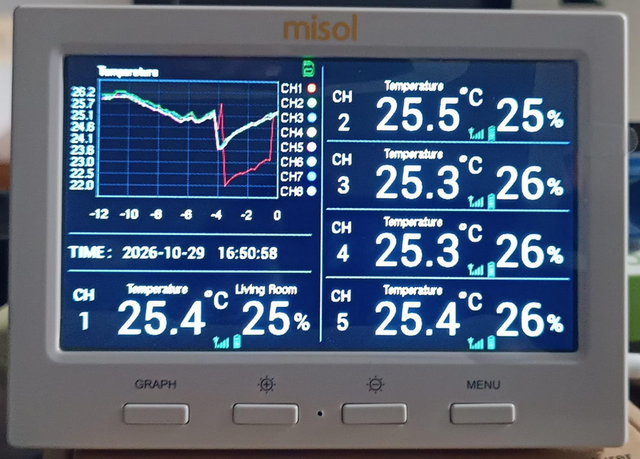
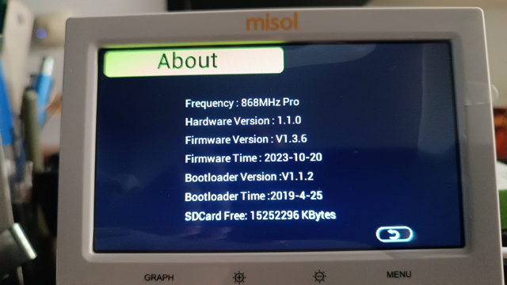

# Misol HP3001 Exporter for Prometheus

  <a href="#english">🇬🇧 English</a> •
  <a href="#russian">🇷🇺 Русский</a> •
  

  
  

---

## 🇬🇧 English
Just Prometheus exporter for Misol HP3001 meteostation.   

The Misol H3001 is essentially a USB-connected console used for partial control and for viewing data from sensors (up to 8 channels) connected to the "base unit."

  
About using several weather stations in one place.

It is possible to use multiple base stations simultaneously (tested with two bases, each with 8 sensors was connected), but there is a specific detail regarding the addition of sensors. Each base station stores the sensor ID for a given channel (presumably in its flash memory). If you attempt to add a new sensor to a channel that is already occupied by another, it will not function until you perform a re-registration for that channel (via the "Re-register sensors" menu). The re-registration process clears the existing sensor ID from the selected channel; subsequently, the first sensor from which the base station receives data will be assigned to that channel.

Therefore, to use multiple base stations in the same environment, simply connect the respective sensors to each base station while the sensors belonging to the other base station are powered off. If not all sensor channels on a given base station are in use, it is advisable to disable the unused channels (also via the "Re-register sensors" menu) to prevent sensors from the other base station from inadvertently registering to those channels.

If you are certain that connecting a second device will not be required, you can use the device index (the default behavior); otherwise, it is better to run the exporter in a mode where the device is identified by its internal HW ID (see the `--use-serial-number` flag).

> Warning: 
> EasyTemp is not designed to work with multiple connected weather stations simultaneously. I can't predict its behavior in such a situation.
---

 
Features:
-  Directly retrieves temperature (including negative values) and humidity data from the sensors. 
- Synchronizes the base unit's clock with the computer's clock (see the `--update-clock-freq X` command-line option).
- Logs data (disabled by default).
- Uses the base unit's serial number as a device identifier (enabled via the `--use-serial-number` option; otherwise, the device index is used by default).

The project https://github.com/cktben/mqtt-misol-hp3001 served as a starting point. Although it did not handle negative temperatures, it proved very useful as a foundation.

Command-line options:\
`misol-hp3001-exporter-go.exe` `-h | --help`     -> Show help and exit.
`misol-hp3001-exporter-go.exe` `-v | --version`  -> Show version information and exit.

`misol-hp3001-exporter-go.exe [port [interval]] [--use-serial-number] [--error-log path/to/log.file] [--update-clock-freq X]`

`[port [interval]]` -\> If an interval other than the default (30 seconds) is required, you must also specify the port in the command line (the default is 9100).

`--use-serial-number` -\> Uses the device's serial number (if available) as the device identifier in metrics; otherwise, an index is used.

`--error-log path/to/log.file` -\> Writes logs to a file; the path can be relative or absolute.

`--update-clock-freq X` -\> --update-clock-freq X — if this parameter is specified (where X is a positive integer), the time on the base unit will be updated every X polling cycles. If this parameter Is Not set, the time will be updated during the initial poll of the device, as well as whenever the device reappears after having been offline.

> For example:\
> If X=5 and the default polling interval is used, the time on the base unit will be updated every 2.5 minutes, as well as during the initial poll of the device.

---

## 🇷🇺 Русский
Просто Prometheus экспортер  для метеостанции Misol HP3001.  

Misol H3001 - по сути USB табло для управления(частично) и просмотра данных подключенных к "базе" датчиков(8 каналов).

  
Про использование нескольких метеостанций в одном месте.

---

Можно использовать несколько базовых станций сразу(протестировано с двумя базами по 8 сенсоров на каждой), но есть нюанс по добавлению сенсоров. Станция запоминает id сенсора на канале(полагаю в флэш пишет). Если вы попробуете добавить новый сенсор на канал где уже стоял другой - он работать не будет пока вы не выполните перерегистрацию сенсора на этом канале(в меню "Re-register sensors"). Процесс перегистрации заключается в том, что стирается идентификатор старого сенсора на нужном канале, а дальше первый сенсор от которого база получит данные будет прописан на этом канале.

Таким образом, чтобы использовать несколько баз в одном пространстве, надо просто подключить к каждой из них свои сенсоры в момент когда сенсоры другой базы обесточены. Если на одной из баз задействованы не все каналы сенсоров, то лучше отключить неиспользуемые каналы(тоже в меню "Re-register sensors"), чтобы на эти каналы не подвязались сенсоры чужой базы.

Если вы уверены что вторую базу подключать не потребуется, можно использовать индекс для устройства(по умолчанию), в противном случае лучше запускать экспортер в режиме когда устройство именуется по своему внутреннему HW ID(см. ключ `--use-serial-number`).

> Предупреждение: 
> Программа EasyTemp не предназначена для работы сразу с несколькими подключенными метеостанциями. Поведение её в такой ситуации предсказать не могу.
---

 
Что умеет экспортер:
- Непосредственно отдавать температуру(в том числе отрицательную) и влажность с датчиков.
- Выполнять синхронизацию часов "базы" с часами компьютера(см. опцию командной строки "--update-clock-freq X")
- Писать лог(по умолчанию отключен)
- Использовать серийный номер "базы" в качестве идентификатора устройства(с опцией --use-serial-number, по-умолчанию используется индекс устройства).

В качестве отправной точки был использован проект [https://github.com/cktben/mqtt-misol-hp3001](https://github.com/cktben/mqtt-misol-hp3001). Правда там нет работы с отрицательными температурами, но для в качестве отправной точки для нейронки проект был весьма полезен.

Опции командной строки:\
`misol-hp3001-exporter-go.exe` `-h | --help`     -> Выводит ключи запуска.
`misol-hp3001-exporter-go.exe` `-v | --version`  -> Выводит версию.

`misol-hp3001-exporter-go.exe [port [interval]] [--use-serial-number] [--error-log path/to/log.file] [--update-clock-freq X]`

`[port [interval]]` -\> Если требуется интервал опроса отличный от дефолтового(30 seconds), также надо указать порт(default 9100).

`--use-serial-number` -\> Использовать серийный номер(если доступен) в качестве идентификатора устройства в метриках; иначе используется индекс.

`--error-log path/to/log.file` -\> Запись лога в файл; путь может быть абсолютный, или относительный.

`--update-clock-freq X` -\> если задан параметр(X - положительное целое), время базы синхронизируется с часами ПК каждый X-ый опрос устройства. Если параметр не задан, то синхронизация выполняется при запуске, а также каждый раз, когда устройство снова появляется "в сети" после того, как было недоступно(если продолжительность отключения не менее 1 сек).

> Например:\
> Если X=5 и используется интервал опроса по умолчанию, время на базовом устройстве будет обновляться каждые 2,5 минуты, а также во время первоначального опроса устройства. 